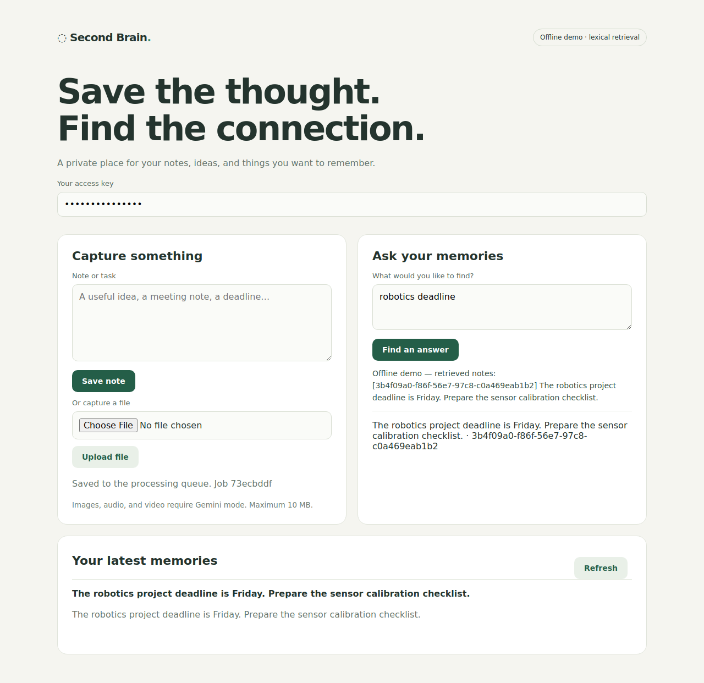

# Validation

Checks performed on 9 October 2026.

- 9 tests passed, including SQLite/Qdrant persistence, owner isolation, exclusive job claims, lease recovery, ingestion idempotency, partial-index retry, citation checks, API limits, and Telegram webhook authorization.
- Ruff checks passed.
- Text capture, background processing, question answering, and citations passed a headless Chrome walkthrough with no page errors.
- Gemini media/schema requests were validated with mocked HTTP transport.

Live Gemini, Telegram, and Notion calls require your account credentials. The Docker Compose configuration was parsed and inspected, but a Docker daemon was unavailable for a full container-stack run.

